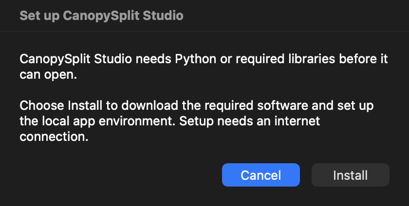
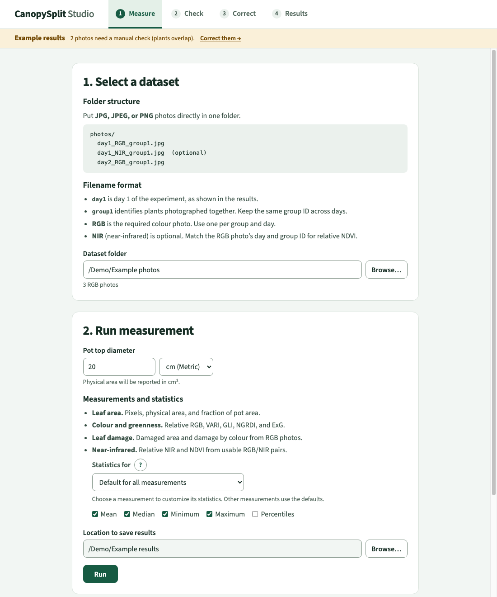
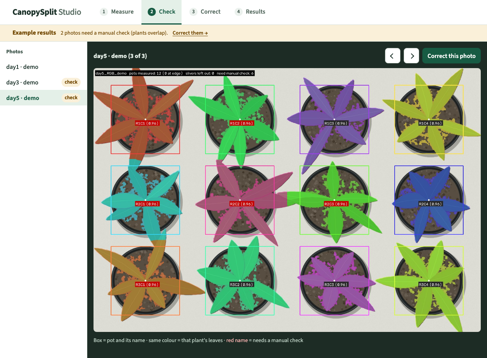
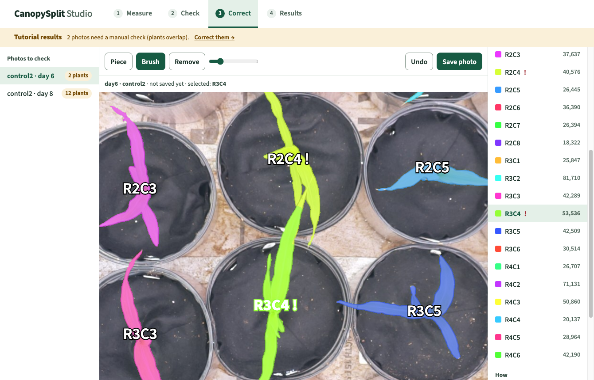
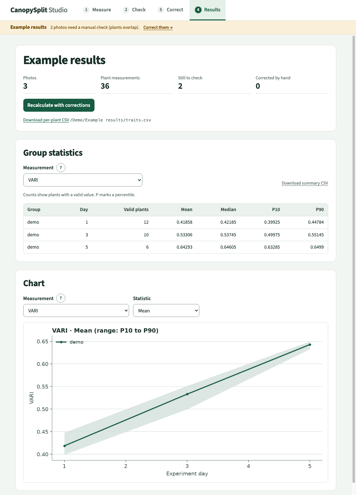

# CanopySplit Studio

[](LICENSE)
[](#install-and-open)
[](#install-and-open)
[](models/README.md)
[](#measure-a-dataset)


CanopySplit measures visible leaf area and color for individual potted plants
from overhead photos. It uses YOLO26s to find pots and geodesic leaf assignment
to separate visible foliage. It runs on your computer and opens in your browser.
You can review the automatic results and correct flagged leaf assignments by hand.

The detector and segmentation settings were developed on maize seedlings in
chilling and light-stress experiments. Check a small set of images when trying
another plant type or camera setup.

[Install](#install-and-open) · [Prepare photos](#prepare-your-photos) · [Measure](#measure-a-dataset) · [Results](#results)

## Video walkthrough

https://github.com/user-attachments/assets/8b413d63-f950-4b0c-96f2-6f2ade124285

## Install and open

1. On GitHub, choose **Code → Download ZIP**. On Mac, double-click the ZIP in
   Finder. On Windows, right-click the ZIP in File Explorer and choose **Extract All**.
2. Open the extracted folder and double-click the launcher for your computer.

   | Computer | Launcher |
   | --- | --- |
   | Apple silicon Mac | `start_mac.command` |
   | 64-bit Windows on an Intel or AMD PC | `start_windows.bat` |

3. If the launcher asks to set up CanopySplit, choose **Install** to allow it to
   download Python 3.11 and the required libraries. Choose **Cancel** to exit
   before setup. A fresh setup needs an internet connection.
4. Wait for CanopySplit to open in your default browser. Keep the launcher
   window open while you use the app. Later launches open the app directly once
   the software check passes.

On Mac, the setup prompt looks like this.



If macOS asks you to approve the downloaded launcher, follow
[Apple’s instructions for opening downloaded software](https://support.apple.com/en-us/102445).

### Download and disk space

| Fresh installation | Apple silicon Mac | 64-bit Windows |
| --- | ---: | ---: |
| Source ZIP, including the pot detector | About 21 MB | About 21 MB |
| Additional download after clicking **Install** | About 314 MB | About 354 MB |
| **Total download** | **About 335 MB** | **About 375 MB** |
| Installed folder, including package cache | About 2.2 GB | About 1.2–2.2 GB |

Allow about **2.5 GB of free disk space** for setup, plus space for your photos
and results. Downloads are compressed. The installed folder includes unpacked
libraries and the package cache. The Mac figures come from a clean install.
CanopySplit also ran successfully in a Windows test. The Windows sizes are
estimates based on the installer’s package files. Sizes can vary as dependencies change.

### Where setup saves files

A fresh automatic setup keeps Python in `.canopysplit/python`, libraries in
`.venv`, and cached downloads in `.canopysplit/uv-cache`, all inside the
extracted folder. CanopySplit also stores its recent results list in `.canopysplit`.
To remove CanopySplit, close the launcher and delete the folder. Back up any
photos or results you saved inside it first.

<details>
<summary>Storage used by earlier setups</summary>

An existing installation can keep using its original Python. Older downloads
may still be in `~/.local/share/uv/python` and `~/.cache/uv` on Mac, or
`%APPDATA%\uv\data\python` and `%LOCALAPPDATA%\uv\cache` on Windows.

</details>

## Prepare your photos

Put JPG, JPEG, or PNG photos directly in one folder. Use filenames like these.

```text
photos/
  day1_RGB_group1.jpg
  day1_NIR_group1.jpg  (optional)
  day2_RGB_group1.jpg
```

- **`day1`** means experiment day 1 in tables and charts (`day` in the CSV).
- **`group1`** identifies plants photographed together (`treatment` in the CSV).
  Give each group its own ID and use it across days. Names such as `bench2` and
  `greenhouseA` work too.
- **RGB** is the color photo. Use one per group and day.
- **NIR** is an optional near-infrared or NoIR photo. Match the RGB photo’s day
  and group ID. An aligned pair can provide relative NIR and NDVI measurements.

## Measure a dataset

| Step | Approach | What to do |
| --- | --- | --- |
| **1** | **Measure** | Browse to your dataset, enter the pot’s top diameter in cm or inches, and choose your measurements and statistics. Use **Location to save results** to pick an output folder, then click **Run**. |
| **2** | **Check** | Review the RGB overlays for pot IDs and leaf assignments. `R2C5` means row 2, column 5. For an aligned pair, select **Aligned NoIR** to check the alignment and see pixels excluded by the contrast filter. |
| **3** | **Correct** | For a flagged photo that needs correction, select a plant, then click or paint the visible leaves that belong to it. Click **Save photo** when finished. |
| **4** | **Results** | View the tables and choose a measurement and statistic to display one chart at a time. After saving corrections, click **Recalculate with corrections**. |

In **Measure**, use **Statistics for** to set defaults or customize a measurement.
Choose mean, median, minimum, or maximum, and enter up to three percentiles
between 0 and 100 if needed. Use **Use defaults** to remove a custom selection.

To reopen a run, choose **Measure → Open saved results → Browse…**. CanopySplit
opens it in **Check**. Keep the original photos accessible for corrections and
recalculation. If you measure replacement photos, choose a new output folder.

## CanopySplit in action

Check and Correct use real maize photos from the video walkthrough. Measure
and Results show a synthetic example.

**1. Measure** shows the dataset folder, pot diameter, and statistics options.



**2. Check** shows numbered pots and colour-coded leaf assignments in the RGB overlay. Red labels mark plants flagged for review.



**3. Correct** shows a close-up of two crossing leaves after the Brush tool reassigns part of a leaf to pot R3C4.



**4. Results** shows a color index across experiment days and links to download the per-plant and summary CSVs.



## Results

The default output folder is `results/<dataset-folder>/` next to the CanopySplit
folder. Use **Location to save results** to choose another place. The main files
are listed below.

| Location | Contents |
| --- | --- |
| `traits.csv` | One row per plant per photo |
| `qc_images/` | Review images, including NoIR previews when available |
| `summary/summary.csv` | Selected statistics for each group and day |
| `summary/summary_*.png` | Charts for selected measurements |
| `corrections/` | Saved edits to leaf assignments |

### What the measurements mean

Click **?** beside a measurement selector for its definition.

| Measurement | What it describes |
| --- | --- |
| **Leaf area** | The area of visible leaves in the overhead image. The pot diameter provides the scale for cm²customize|
| **Color and greenness** | Relative RGB signals and indices such as VARI, GLI, NGRDI, and ExG. |
| **Visible damage** | The area or share of visible leaves classified by an RGB colour rule. Lighting and natural pigmentation can affect it. |
| **Relative NIR and NDVI** | Estimates from usable pixels in an aligned RGB and NoIR pair. Green-tissue and damaged-tissue NDVI use the same index on different sets of pixels classified by the RGB photo. |

<details>
<summary>CSV columns and formulas</summary>

**Leaf area**

| Column | Meaning |
| --- | --- |
| `leaf_area_px` | Number of RGB pixels assigned to the plant’s visible leaves. |
| `leaf_area_cm2` or `leaf_area_in2` | Projected leaf area scaled using the pot’s top diameter. |
| `leaf_area_pot_frac` | Visible leaf area divided by the area of the detected pot’s bounding box. |

**RGB color and greenness**

Here `R`, `G`, and `B` are signals standardized against a white reference.
The indices are calculated per pixel and averaged across each plant’s visible leaves.

| Column | Meaning |
| --- | --- |
| `R_rel`, `G_rel`, `B_rel` | Mean relative red, green, and blue signals. |
| `VARI` | Visible Atmospherically Resistant Index, `(G − R) / (G + R − B)`. |
| `GLI` | Green Leaf Index, `(2G − R − B) / (2G + R + B)`. |
| `NGRDI` | Normalized Green–Red Difference Index, `(G − R) / (G + R)`. |
| `ExG` | Excess Green, `2G − R − B`. |

**Visible damage**

The default color rule classifies leaf pixels with an Excess Green score above
20 on the original 8-bit RGB values as green. The other leaf pixels count toward
visible damage under that rule. The exported `ExG` uses standardized RGB.

| Column | Meaning |
| --- | --- |
| `damaged_frac` | Area classified as damaged divided by the full visible leaf area. A value of 0.20 means 20%. |
| `damaged_area_cm2` or `damaged_area_in2` | Area classified as damaged in the selected square unit. |
| `dmg_yellow_frac`, `dmg_pinkred_frac`, `dmg_brown_frac` | Area for each color class divided by the full visible leaf area. |
| `dmg_yellow_area_pot`, `dmg_pinkred_area_pot`, `dmg_brown_area_pot` | Area for each color class divided by the area of the detected pot’s bounding box. |

**Relative NIR and NDVI**

NDVI compares estimated near-infrared and red signals using
`(NIR − red) / (NIR + red)`. The mean is calculated over usable pixels in each region.

| Column | Meaning |
| --- | --- |
| `NIR_rel` | Mean estimated near-infrared signal, adjusted for visible light and standardized using a white reference. |
| `NDVI` | Mean relative NDVI over all usable leaf pixels. |
| `NDVI_green_tissue` | Mean relative NDVI over usable leaf pixels classified as green by the RGB rule. |
| `NDVI_damaged_tissue` | Mean relative NDVI over usable leaf pixels classified as damaged by the RGB rule. |

**Identifiers and quality**

| Column | Meaning |
| --- | --- |
| `day`, `treatment`, `pot_id` | Experiment day, group ID, and plant position. |
| `nir_valid_frac` | Share of the RGB leaf mask with usable pixels after NoIR filtering. |
| `edge_cut` | `yes` for a pot partly outside the photo. Area summaries skip these pots. |
| `reliable` | `no` for an unreviewed plant flagged for leaf overlap. |
| `mask_source` | `auto` for automatic leaf assignments or `manual` for a saved correction. |

</details>

<details>
<summary>How the summaries handle missing values and corrections</summary>

In `summary.csv`, `n_plants` counts eligible plants, and each measurement has
its own `_n` count of valid values. A measurement with all statistic boxes
cleared shows only its valid count. Missing statistics are blank. By default,
groups with fewer than five eligible plants on a given day are left out of the
summary, and area statistics exclude pots cut off by the image edge.

The chart shows a range from the lowest to highest selected percentile when at
least two are available. Recalculation uses the saved area unit and statistics.
Older runs without saved statistic choices use the defaults. Manual corrections
can carry into a rerun when the photos and pot positions still match.

</details>

## Limitations

- **Hidden leaves.** CanopySplit measures only what is visible from above.
  Review assignments when neighboring foliage touches or overlaps.
- **Pot positions.** The grid fitter expects four rows by default. Check IDs
  when the framing changes or a row or column is missing.
- **Colour reference.** Calibrated color indices require a usable white
  background reference. The color card in the original photos had glare and
  was unused.
- **Relative NDVI.** Treat these values as relative to your camera and lighting
  setup. The original NoIR camera used automatic exposure and had no filter.
  Check alignment and usable leaf coverage before interpreting the values.

<details>
<summary>NoIR filtering details</summary>

The filter uses the RGB leaf outlines to select candidate pixels in the aligned
NoIR image. It excludes pixels outside the image, pixels along blended borders,
and pixels with negative corrected reflectance. It keeps pixels clearly brighter
than nearby NoIR background and trims a one-pixel rim to reduce mixing.

**Check → Aligned NoIR** marks pixels rejected by the contrast filter in orange.
Each measured region needs at least 50 usable pixels. A value can describe only
part of a leaf, especially if the tissue is dark. Bright background and large
shifts between cameras still need visual review.

</details>

## Technical notes

The pipeline detects pots with [YOLO26s](models/README.md), fits a row and column
grid, and assigns segmented RGB leaf pixels to plants using paths through the
foreground. Color standardization uses the camera tone curve and stable
background regions to match images to a group reference. The pipeline then
measures each plant, flags overlap for review, and writes previews and summaries.

<details>
<summary>Command line and repository layout</summary>

Run from a shell with the required Python libraries installed. After automatic
setup, replace `python` in the examples with `.venv/bin/python` on Mac or
`.venv\Scripts\python.exe` on Windows.

```bash
python run_pipeline.py --photos path/to/photos --out-dir ../results/my_dataset --pot-diameter-cm 22.23
python run_pipeline.py --out-dir ../results/my_dataset --recalculate
```

- Use `--photos` with `--recalculate` if the original photos were moved.
- The diameter argument takes centimeters. Use `--area-unit in` for square-inch output.
- Use `--summary-stats mean median` and `--percentiles 10 50 90` to choose statistics.
  Pass either option without values to omit that set.
- Use `--skip-existing` to reuse automatic detections and masks when the RGB
  inputs and weights match. The pipeline rebuilds measurements, previews, and
  summaries with the current corrections. `--no-nir` skips NIR measurements.
- Use `--stages stages.csv` (`treatment, day, stage`) and `--genotypes genotypes.csv`
  (`treatment, pot_id, genotype`) to annotate results.

```text
app.py, app.html   local browser app
assets/            interface font and its license
docs/              setup screenshot
pipeline/          measurement and review steps
models/            trained pot detector
analysis/          optional checks for the original study
```

Use `analysis/validate_ndvi.py --help` to see the color standardization and NDVI
checks, and `analysis/compare_indices.py --help` for the maize study comparison.

</details>

### References

- Gitelson AA, Kaufman YJ, Stark R, Rundquist D (2002). Novel algorithms for remote estimation of vegetation fraction. *Remote Sensing of Environment*, 80, 76–87. [Paper](https://doi.org/10.1016/S0034-4257(01)00289-9)
- Glenn DM, Tabb A (2019). Evaluation of five methods to measure normalized difference vegetation index (NDVI) in apple and citrus. *International Journal of Fruit Science*, 19, 191–210. [Paper](https://doi.org/10.1080/15538362.2018.1502720)
- Schott JR, Salvaggio C, Volchok WJ (1988). Radiometric scene normalization using pseudoinvariant features. *Remote Sensing of Environment*, 26, 1–16. [Paper](https://doi.org/10.1016/0034-4257(88)90116-2)
- Stamford JD, Vialet-Chabrand S, Cameron I, Lawson T (2023). Development of an accurate low-cost NDVI imaging system for assessing plant health. *Plant Methods*, 19, 9. [Paper](https://doi.org/10.1186/s13007-023-00981-8)

## Citation and license

A paper citation will be added if the accompanying study is published.

CanopySplit is distributed under the [GNU Affero General Public License v3.0](LICENSE).
CanopySplit source code copyright © 2026 Worasit Sangjan.

Pot detection uses [Ultralytics YOLO](https://github.com/ultralytics/ultralytics)
and a fine-tuned YOLO26s checkpoint under AGPL-3.0. See the
[model notes](models/README.md) for the training dataset and settings.

The bundled Source Sans 3 font is available under the
[SIL Open Font License 1.1](assets/source-sans-3-OFL.txt).
